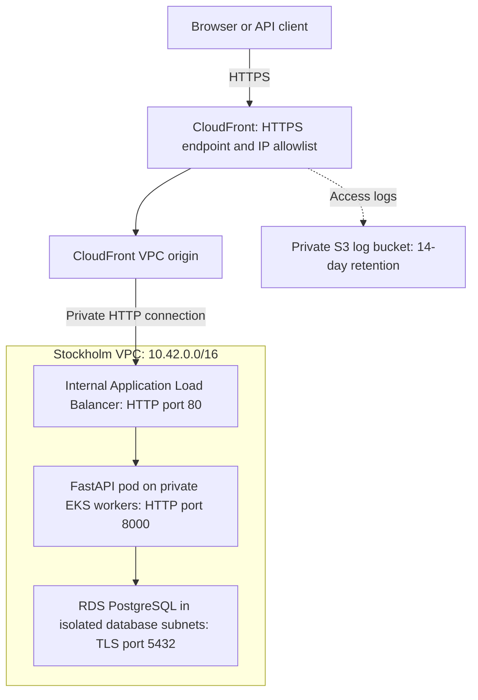

# How this repository works

This repository provisions the AWS infrastructure for a small FastAPI deployment.
Terraform builds the network, Kubernetes cluster, database, deployment tooling,
and HTTPS entry point. The companion [`deploy-aws` repository](../../deploy-aws/README.md)
defines the application resources that run inside Kubernetes.

The environment is named `deployment-project-dev`, targets AWS project
`245361883993`, and uses profile `aws-project`. Regional infrastructure is in
`eu-north-1` (Stockholm). CloudFront is global; its log-delivery configuration
uses `us-east-1`, with the destination bucket in Stockholm.

This guide describes the checked-in configuration and how its components work
when deployed. It applies whether the infrastructure is running, partially
deployed, or removed; it is not a live AWS inventory.

## Request flow



1. A client calls the AWS-provided `*.cloudfront.net` hostname over HTTPS.
   CloudFront supplies the viewer certificate; no custom domain is configured.
2. The configured viewer-request function checks the connection's IPv4 address
   against `eks_admin_cidrs`. Disallowed clients receive `403` before reaching
   the application. The list also limits public Kubernetes API access. It allows
   exact `/32` addresses, and CloudFront IPv6 is disabled.
3. CloudFront forwards permitted requests through its VPC origin to the private
   ALB. TLS terminates at CloudFront; this internal connection uses HTTP.
4. The ALB routes requests to the application pod on port `8000`. The Ingress
   and Service in `deploy-aws` describe this routing. The Ingress uses IP targets,
   so the ALB sends traffic directly to pod IPs; the Service defines which pods
   are selected rather than adding a proxy hop to this diagram.
5. The application connects to private RDS PostgreSQL on port `5432`. RDS
   requires TLS; the companion deployment configures certificate verification.

CloudFront caching is disabled for the API, response headers set
`Cache-Control: no-store`, and supported error-cache TTLs are zero. A
viewer-response function upgrades same-host HTTP redirect locations to HTTPS:
the app sees HTTP behind the ALB, but clients use HTTPS. External and relative
redirect locations are left unchanged.

## Who manages what

There are three cooperating managers. Keeping their responsibilities separate
avoids two systems trying to create or delete the same resource.

| Manager | Responsibility |
| --- | --- |
| Terraform in this repo | VPC, EKS and worker IAM, RDS, the two Helm releases, load balancer controller IAM/Pod Identity, ALB frontend security group, CloudFront, and access-log delivery |
| Argo CD using `deploy-aws` | Kubernetes application configuration, including Deployment, Service, Ingress, and migration Job |
| AWS Load Balancer Controller | ALB, listeners, target groups, and backend security-group rules derived from the application Ingress |

Terraform installs self-hosted Argo CD and the load balancer controller through
Helm. Argo CD's server has a `ClusterIP` service with no public Ingress. App
registration and credentials are bootstrapped separately through the deployment
runbooks; installing the Helm release alone does not deploy the application.

Terraform **looks up** the controller-created ALB by name in
[`cloudfront-origin.tf`](../cloudfront-origin.tf). It checks that the ALB is
internal, IPv4, in the expected VPC, and attached to the expected frontend
security group, then uses it as the CloudFront VPC origin. The ALB itself is
not a Terraform-managed resource.

Application source code, Dockerfiles, and image builds live outside this repo.
Publishing infrastructure code does not release a new application image.

## Infrastructure layers

**Network.** [`network.tf`](../network.tf) defines a VPC across two Availability
Zones, with public subnets, private subnets for EKS workers and the internal ALB,
and isolated database subnets. A single NAT gateway provides outbound access
from the private subnets. Database subnets have no Internet gateway or NAT route.

**Kubernetes.** [`eks.tf`](../eks.tf) defines EKS and two managed `t3.small`
workers, with fixed desired/minimum/maximum size of two. It configures networking,
DNS, kube-proxy, and the Pod Identity agent. The Kubernetes API has private
access plus public access restricted to `eks_admin_cidrs`. The load balancer
controller receives temporary AWS credentials through a dedicated EKS Pod
Identity role rather than stored access keys.

**Database.** [`database.tf`](../database.tf) defines a single-AZ PostgreSQL 17
instance using `db.t4g.micro`, encrypted storage, and a worker-security-group
rule for port `5432`. AWS manages the administrator password in Secrets Manager.
The separate application database login and Kubernetes credentials are
provisioned outside Terraform and app Git. Deletion protection,
`prevent_destroy`, a required final snapshot, retained automated backups, and
one-day backup retention protect the database lifecycle.

**Edge and logs.** CloudFront provides the HTTPS entry point, access functions,
and response headers. Its access logs go to a private, encrypted S3 bucket with
14-day expiry. The selected fields omit query strings, cookies, authorization
headers, referer, and viewer IPs. EKS API, audit, and authenticator logs have
seven-day CloudWatch retention. This is a learning deployment: two workers do
not make the single app replica or single-AZ database highly available, the NAT
gateway is shared, and WAF is not configured.

## Repository map

All root-level `.tf` files form **one Terraform root module**. Their names group
related resources for readability; Terraform follows references and explicit
dependencies, not filename order. `bootstrap/` is a separate root module.

| Path | Purpose |
| --- | --- |
| [`main.tf`](../main.tf) | Terraform/provider requirements, AWS profile, selected Region, project restriction, and default tags |
| [`backend.tf`](../backend.tf) | Root module's remote state configuration |
| [`bootstrap/`](../bootstrap/) | Protected, versioned, encrypted S3 state bucket and its separate state configuration |
| [`network.tf`](../network.tf), [`eks.tf`](../eks.tf), [`database.tf`](../database.tf) | Network, cluster/workers, and PostgreSQL |
| [`argocd.tf`](../argocd.tf) | Helm authentication to EKS and Argo CD installation |
| [`load-balancer-controller.tf`](../load-balancer-controller.tf), [`policies/`](../policies/) | Controller Helm release, Pod Identity, and versioned AWS permissions |
| [`app-ingress.tf`](../app-ingress.tf) | ALB frontend security group and its CloudFront/worker traffic rules; the actual Ingress lives in `deploy-aws` |
| [`cloudfront-origin.tf`](../cloudfront-origin.tf), [`cloudfront.tf`](../cloudfront.tf) | ALB lookup, private VPC origin, distribution, functions, and response policy |
| [`cloudfront-logs.tf`](../cloudfront-logs.tf) | S3 access-log bucket and global-service log delivery |
| [`functions/`](../functions/), [`tests/`](../tests/) | CloudFront JavaScript functions, Node.js behavior tests, and Python teardown tests |
| [`scripts/teardown-all.py`](../scripts/teardown-all.py), [`docs/teardown.md`](teardown.md) | Complete-removal command and its runbook |
| [`eks.auto.tfvars.example`](../eks.auto.tfvars.example) | Example of the shared operator IPv4 allowlist; real values belong in ignored `eks.auto.tfvars` |
| [`CLEANUP_PLAN.md`](../CLEANUP_PLAN.md) | Teardown dependencies and retention choices |

## State and deployment flow

Both Terraform roots are configured to store state in the same S3 bucket,
`deployment-project-tfstate-245361883993-eu-north-1`, under separate keys:

| Root module | State key |
| --- | --- |
| `bootstrap/` | `bootstrap/terraform.tfstate` |
| Repository root | `dev/terraform.tfstate` |

The backends use encryption and native S3 locking. The bootstrap bucket is kept
separate so the application infrastructure can be removed while retaining state
storage. Both checked-in backends expect that bucket to exist. If it is absent,
follow the [backend creation procedure](teardown.md#rebuild-after-deleting-the-backend)
before normal initialization.

Deployment or rebuilding crosses the Terraform/Kubernetes ownership boundary,
so it happens in stages:

1. Provision the VPC, EKS workers, and RDS dependencies.
2. Install Argo CD and the load balancer controller; provision the ALB frontend
   security group and rules.
3. Follow `deploy-aws` to provision credentials, register the app, and update its
   Ingress with the frontend security-group ID from Terraform outputs. Perform
   a full manual app sync, including migrations.
4. Wait for the controller-created ALB to be Active with healthy targets.
5. Run a full Terraform plan/apply for CloudFront, its VPC origin, and logs.
   Verify the endpoint and log delivery, then check for a clean full plan.

The initial stages use the targeted bootstrap procedure in the
[rebuild walkthrough](../../deploy-aws/docs/deploy-from-scratch.md). A full plan
cannot resolve the ALB lookup before the application Ingress has created it.
Routine infrastructure changes use full, untargeted plans. The operator reviews
plans and runs applies; application releases follow the separate `deploy-aws`
process and manual app sync.

For removal, the dependency order matters too: remove the CloudFront distribution
and VPC origin before the ALB, and remove the app Ingress while its controller
still runs. The [complete-removal command](teardown.md) pauses Argo CD and removes
Ingresses directly; the [manual walkthrough](../../deploy-aws/docs/teardown.md)
uses deliberate GitOps pruning. Remove the remaining runtime afterward. The
[cleanup plan](../CLEANUP_PLAN.md) explains retention choices; complete removal
also deletes snapshots/backups, logs, and the state backend.

## Working with changes

Local function and teardown tests do not require a deployed environment:

```sh
node --test tests/*.test.cjs
python3 -m unittest discover -s tests -p 'test_teardown_all.py'
```

The Node.js tests cover IP matching and rejection, spoofed headers, missing
viewer data, and safe HTTPS redirect rewriting. Python tests cover teardown
plan restrictions, phase ordering, failure/resume, and configuration isolation.
These tests do not verify live AWS connectivity, application health, or service
deletion behavior.

See the [README](../README.md#validation-and-changes) for Terraform validation
without a backend and the prerequisites for planning deployed changes. A full
plan requires the ALB and cluster dependencies described above. After deployment,
Terraform outputs expose network IDs, cluster name, database connection metadata,
the ALB frontend group, and the generated CloudFront endpoint.

Commit configuration, provider lock files, public IAM policy JSON, functions,
and tests. Keep real `.tfvars`, Terraform state, binary plans, passwords, and
private keys outside Git. The [README](../README.md) links to the operational
runbooks and describes deployment, changes, and removal.
